# Application and API flow

Flow charts for the Attendance Management System. The diagrams are [Mermaid](https://mermaid.js.org/); they render on
GitHub and in VS Code's Markdown preview (with a Mermaid extension).

Contents: [1 Overview](#1-system-overview) · [2 Sign-in](#2-sign-in-okta-oidc--pkce) · [3 Request guard](#3-api-request-guard-every-api-call) ·
[4 Sign-out](#4-sign-out) · [5 Uploads](#5-uploading-files) · [6 Processing](#6-processing-a-month) ·
[7 Viewing](#7-viewing-results) · [8 Edits](#8-manual-edits-wednesdays-hours-holidays-leaves) · [9 Export](#9-excel-export) ·
[10 Access admin](#10-access-management-superadmin) · [11 Endpoints](#11-endpoint-map)

---

## 1. System overview

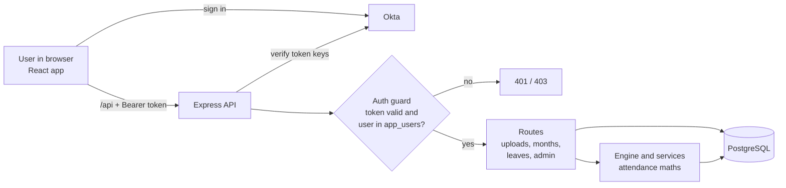

---

## 2. Sign-in (Okta OIDC + PKCE)

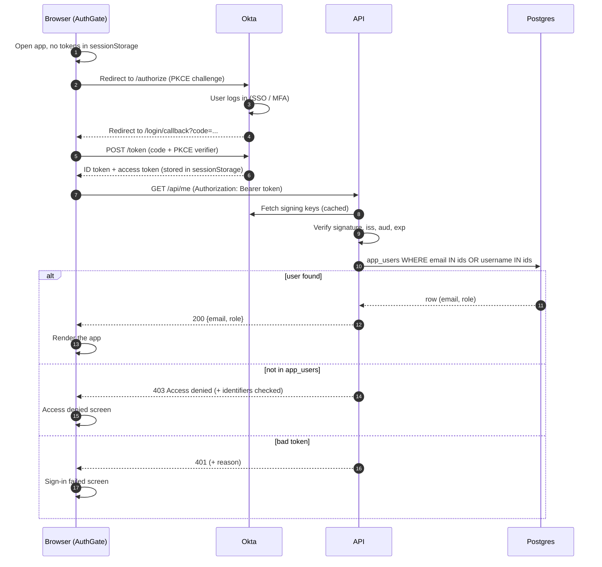

Which token is sent: org server issuer (no `/oauth2` in the URL) sends the **ID token**; a custom or default server sends the
**access token**.

### AuthGate screen states

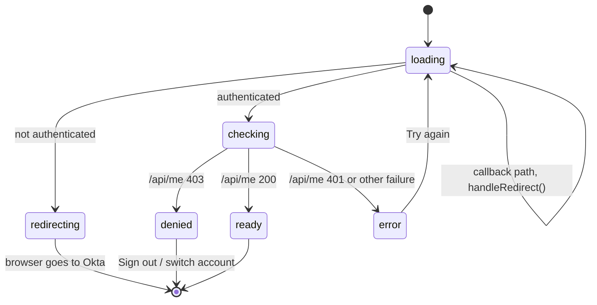

---

## 3. API request guard (every `/api` call)

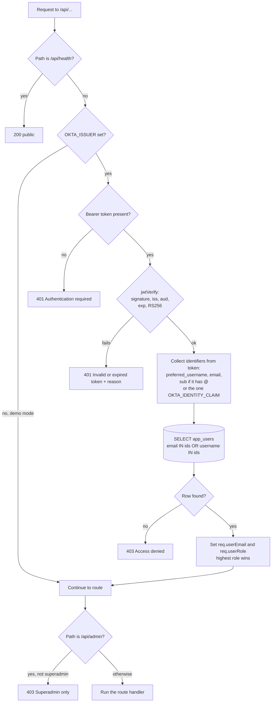

On the browser side, a 401 on a normal call clears the tokens and sends the user back to Okta, at most once per minute.

---

## 4. Sign-out

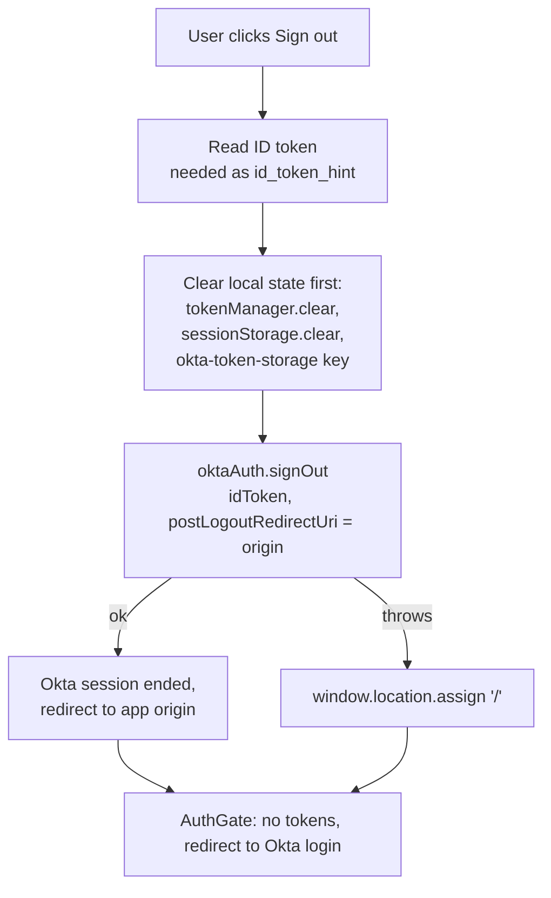

Both steps matter: clearing local tokens removes the app's session, and ending the Okta session stops Okta from signing the same
user straight back in.

---

## 5. Uploading files

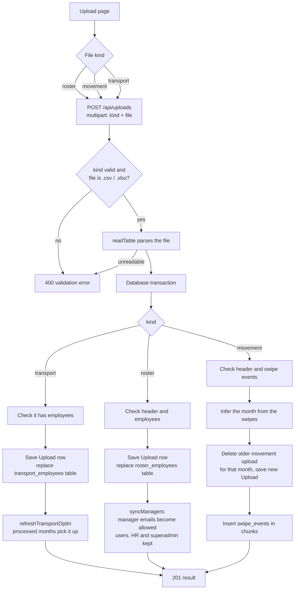

Other upload endpoints:

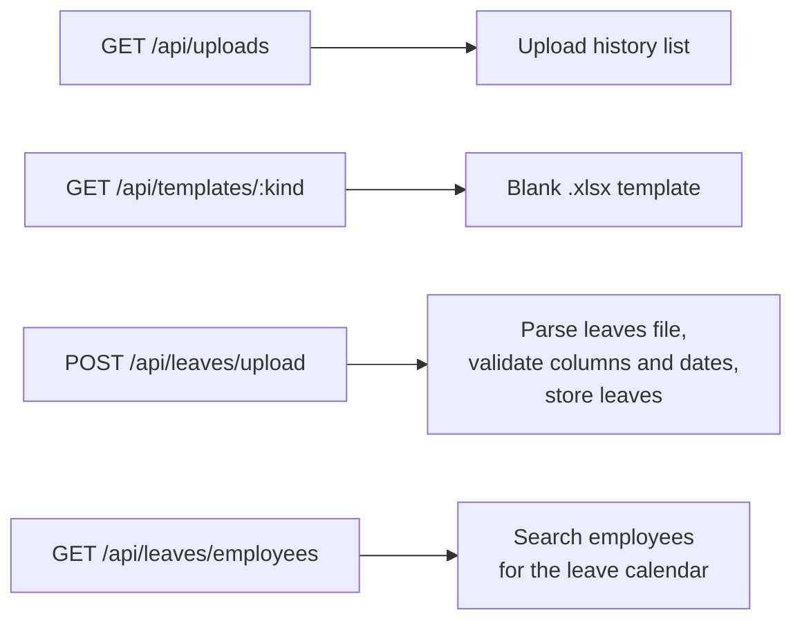

---

## 6. Processing a month

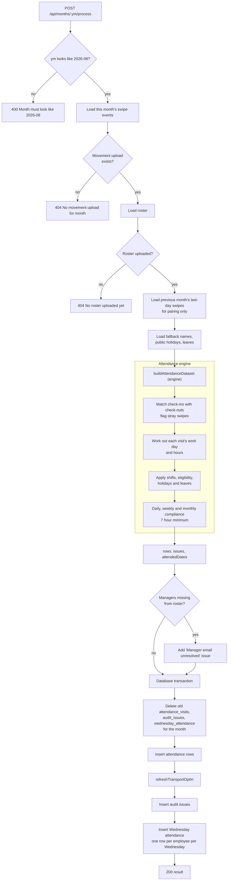

Deleting a month: `DELETE /api/months/:ym` removes its processed data and uploads.

---

## 7. Viewing results

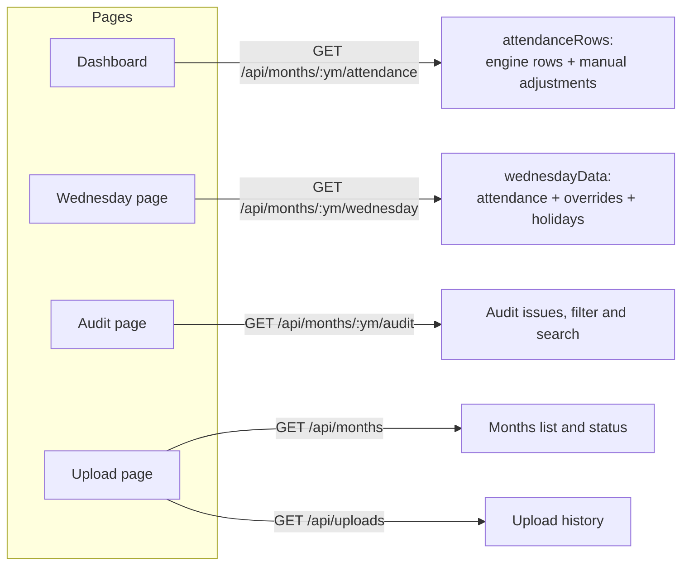

The app loads the month list first, then the selected month's data. The frontend maths (hours, manager totals, Wednesday
tiers) are in `frontend/src/lib/`.

---

## 8. Manual edits (Wednesdays, hours, holidays, leaves)

### Daily hours (add, edit, delete)

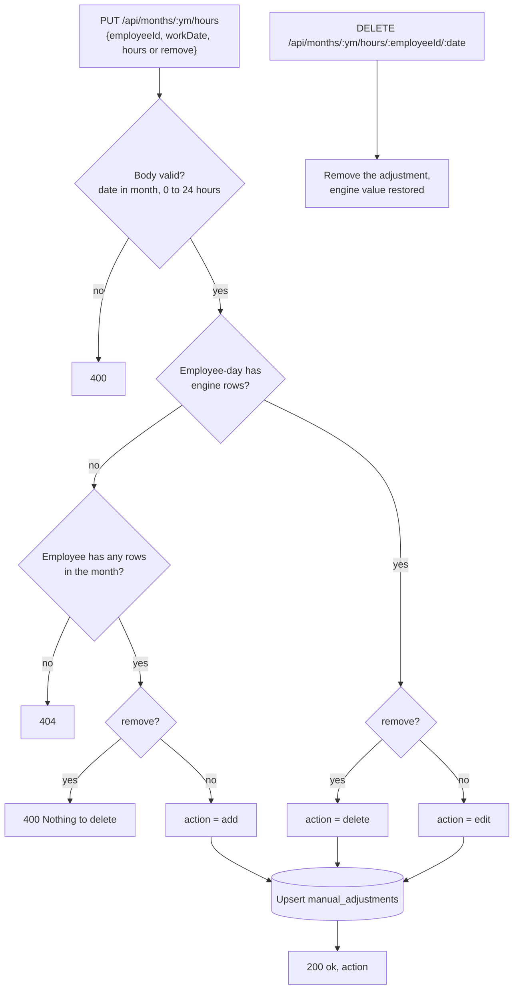

Adjustments are stored separately and applied on read (`applyAdjustments`), so the engine's own results are never overwritten.

### Wednesday override, holidays, leaves

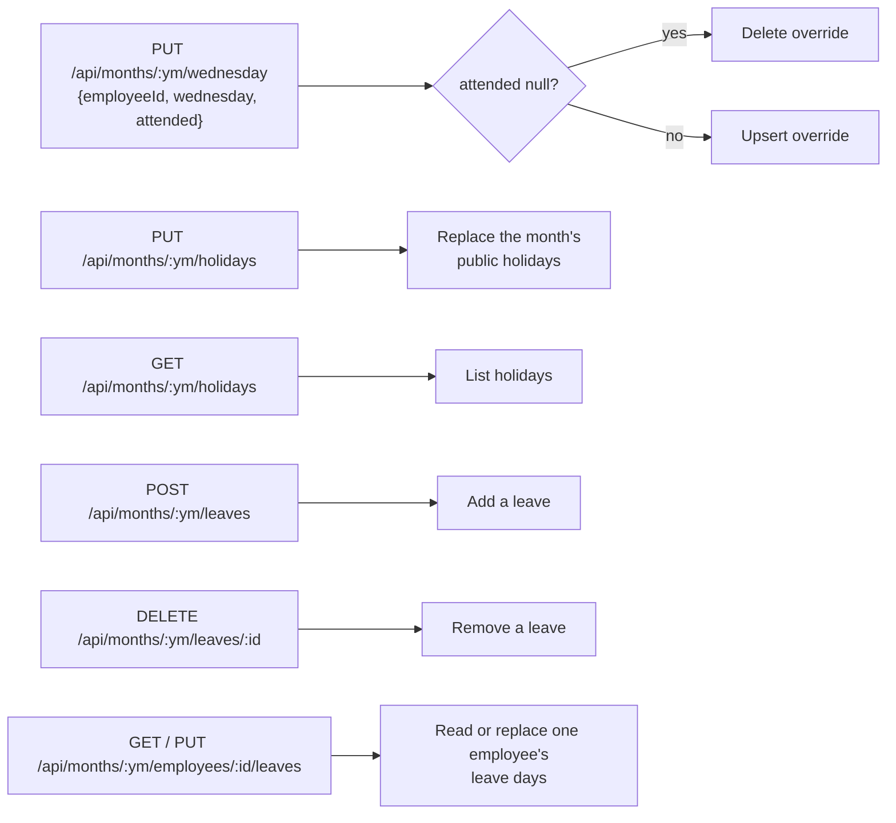

Holidays and leaves change the working days used the **next time the month is processed**, so reprocess after editing them.

---

## 9. Excel export

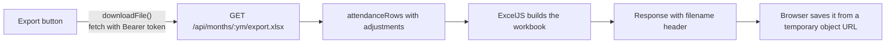

A plain link cannot send the Authorization header, which is why downloads and template downloads go through `downloadFile`.

---

## 10. Access management (superadmin)

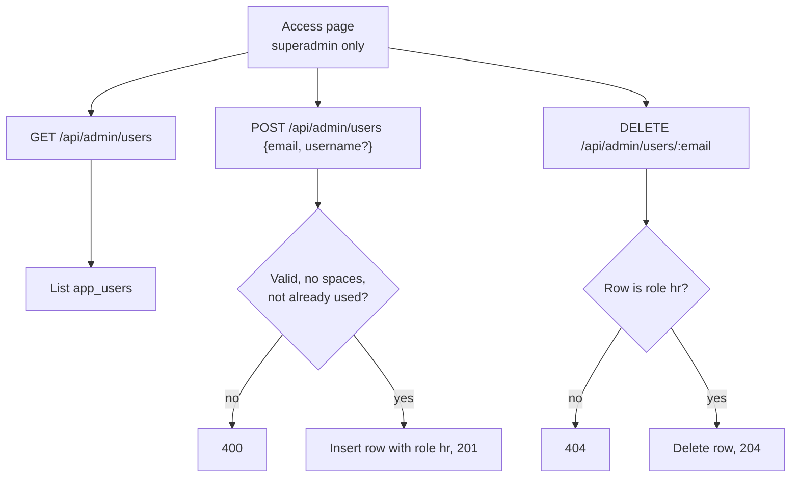

Who is in `app_users`: **superadmin** is inserted by hand in the database, **managers** come from each roster upload, **HR** are added on
this page. A roster upload replaces only the manager rows.

---

## 11. Endpoint map

| Method and path | Auth | Purpose |
|---|---|---|
| `GET /api/health` | none | Liveness and DB time |
| `GET /api/me` | allowed user | Email and role of the signed-in user |
| `GET /api/templates/:kind` | allowed user | Blank upload template |
| `POST /api/uploads` | allowed user | Upload roster, movement or transport file |
| `GET /api/uploads` | allowed user | Upload history |
| `GET /api/months` | allowed user | Months and their status |
| `POST /api/months/:ym/process` | allowed user | Run the engine for a month |
| `DELETE /api/months/:ym` | allowed user | Delete a month's data |
| `GET /api/months/:ym/attendance` | allowed user | Attendance rows (with adjustments) |
| `GET /api/months/:ym/audit` | allowed user | Data problems found |
| `GET` / `PUT /api/months/:ym/wednesday` | allowed user | Wednesday matrix, and override one cell |
| `PUT /api/months/:ym/hours` | allowed user | Add, edit or delete a day's hours |
| `DELETE /api/months/:ym/hours/:employeeId/:date` | allowed user | Undo an adjustment |
| `GET /api/months/:ym/export.xlsx` | allowed user | Excel download |
| `GET` / `PUT /api/months/:ym/holidays` | allowed user | Public holidays for the month |
| `GET` / `POST /api/months/:ym/leaves`, `DELETE …/leaves/:id` | allowed user | Leaves for the month |
| `GET` / `PUT /api/months/:ym/employees/:employeeId/leaves` | allowed user | One employee's leaves |
| `POST /api/leaves/upload`, `GET /api/leaves/employees` | allowed user | Leaves file upload, employee search |
| `GET` / `POST /api/admin/users`, `DELETE /api/admin/users/:email` | superadmin | Manage HR users |

Status codes: **401** missing or invalid token, **403** valid token but not in `app_users` (or not superadmin on `/api/admin`),
**400** invalid input, **404** missing data. With `OKTA_ISSUER` empty the guard is skipped (demo mode).
